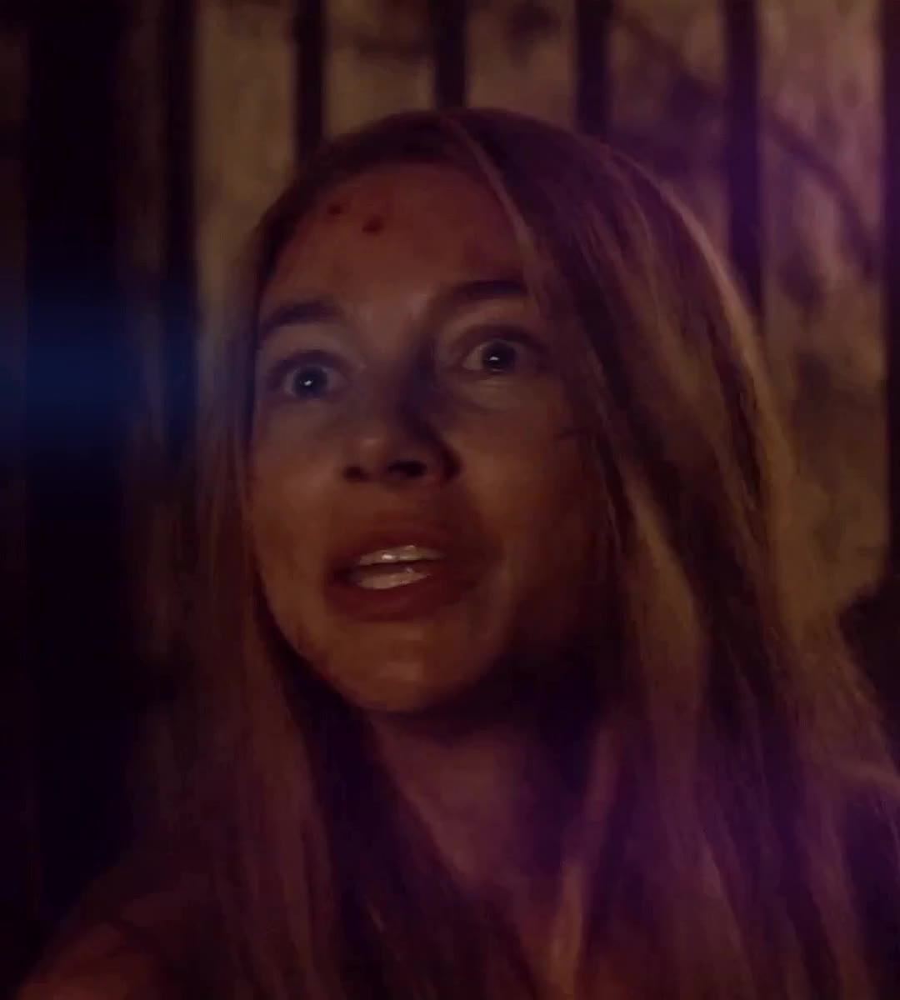
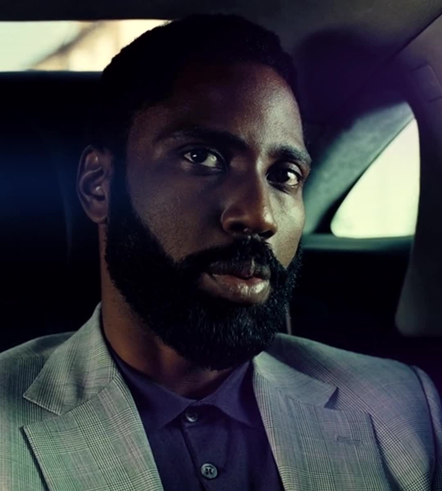
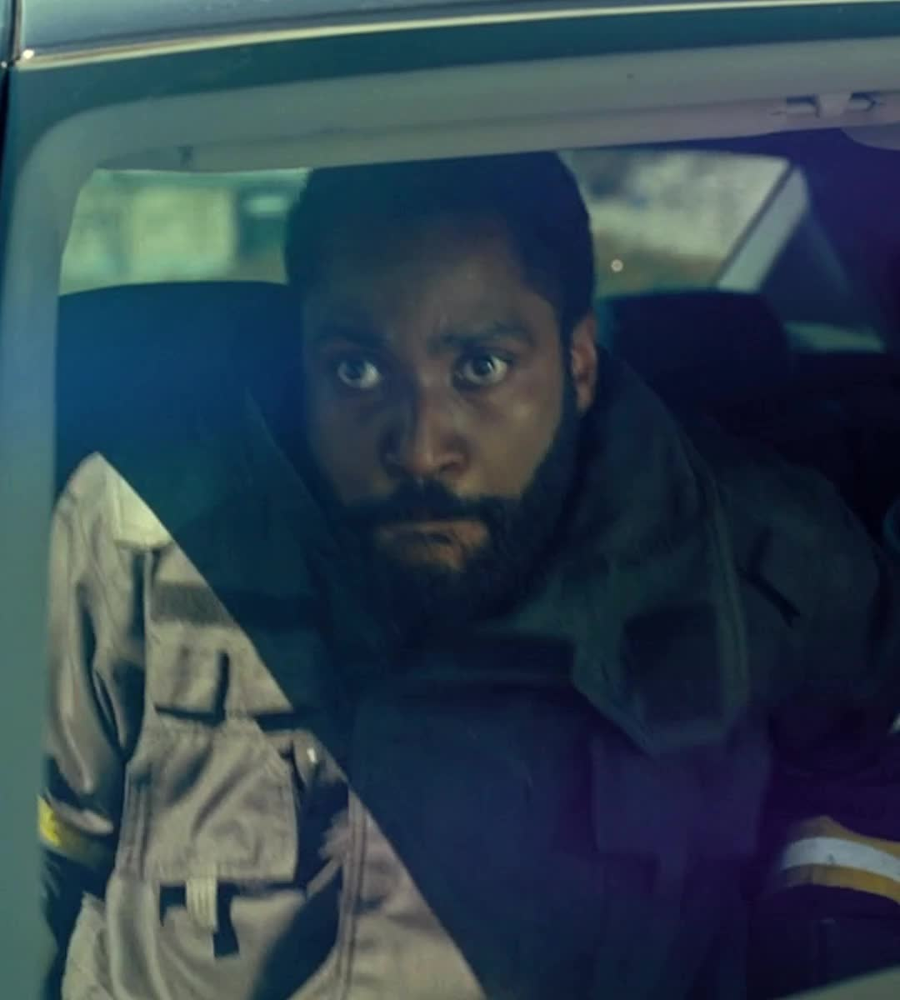
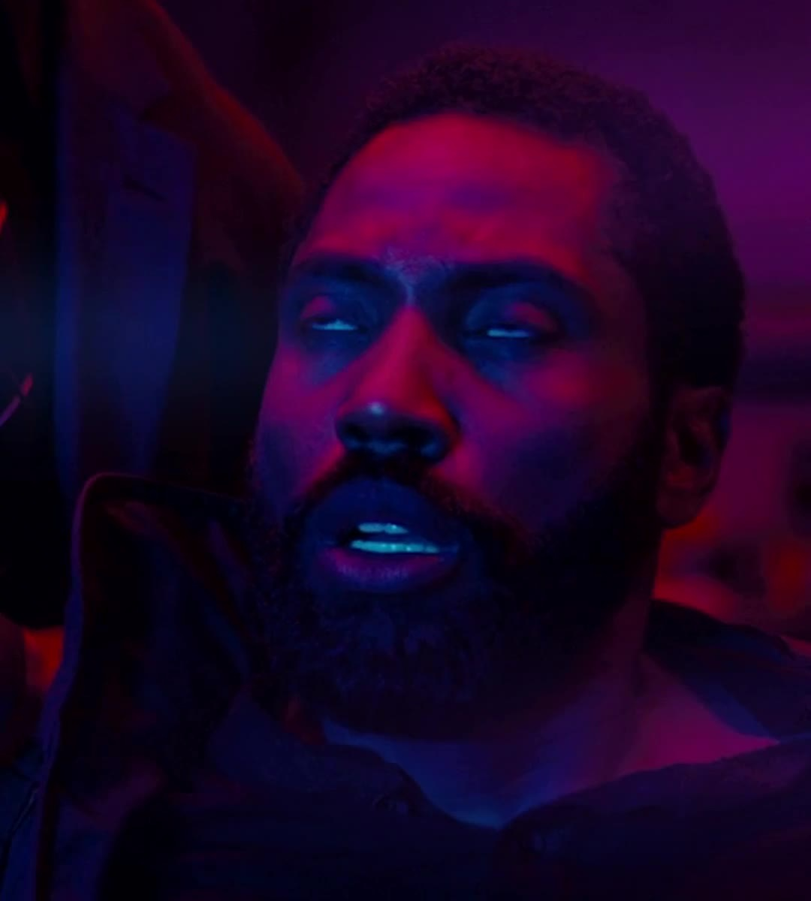
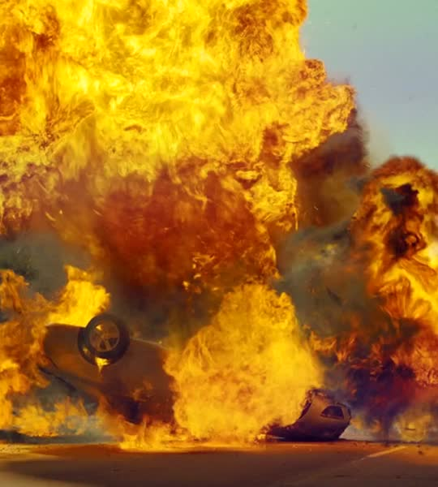
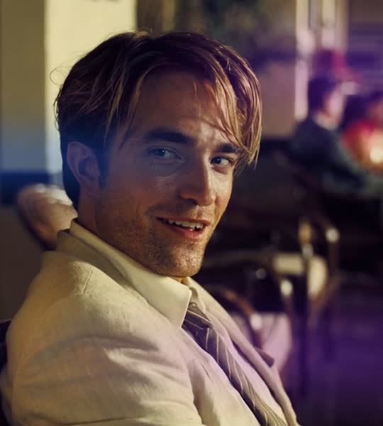
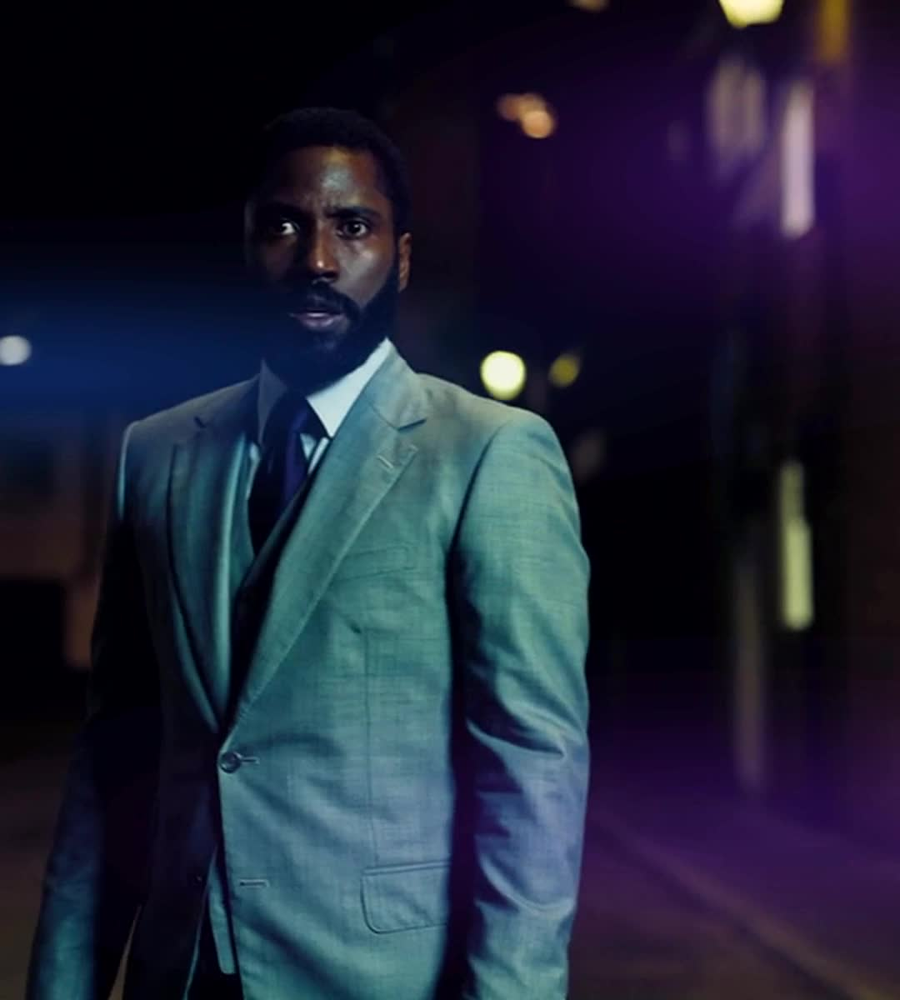
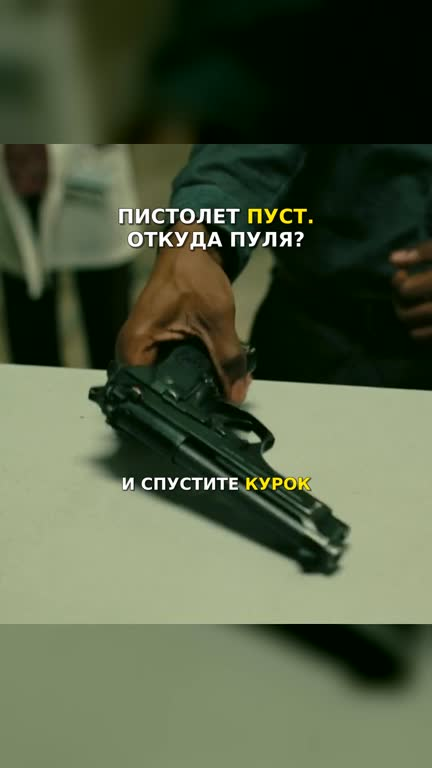

# Кино — короткие нарезки

## Новый фильм: «Поворот не туда: Наследие» (2021) — 39 секунд

Цена спасения: Джен пытается защитить Дариуса и договориться с главой общины. Хук — «Покалечите его — и всё потеряете». Затем героине приходится ответить, что она сама может предложить. Разговор развивается последовательно; длинная пауза перед ответом сокращена.

Русская озвучка, слышимая музыка из первого примера, плавное кадрирование лиц и прежняя сине-фиолетовая обработка. Речь отделена от фоновой музыки фильма и выровнена по громкости. Без субтитров и текстовых вставок.

В конце — пять разных планов именно Джен, с быстрыми зум-переходами, размытием, отражением краёв и световыми вспышками по [видео-примеру](https://drive.google.com/file/d/1TmnbmfIY29RHCLPxlcYzb5EmSrNVRRfg/view).

| Версия | Размер кадра | Файл |
| --- | --- | --- |
| Пропорции как в примере | 1080 × 1200 | [Скачать MP4](videos/wrong_turn_survival_no_subtitles.mp4) |
| Shorts, 9:16 | 1080 × 1920 | [Скачать MP4](videos/wrong_turn_survival_no_subtitles_shorts.mp4) |

Оба ролика: 38,8 секунды, 30 кадров/с, H.264, стереозвук AAC.

## Новый ролик: разговор с Прией — 48 секунд

Хук: «Сделай это, пока мальчик не вышел». Приказ Прии прерывает главный герой; разговор о данном слове и «хвостах» приводит к раскрытию того, кто на самом деле руководит операцией. Основная сцена идёт последовательно. Повторное проигрывание телефонной записи и отдельный план Кэт убраны.

Ролик построен на диалоге. Музыка из первого примера заметнее под репликами и усиливается в концовке. Русская озвучка, плавное кадрирование лиц и прежняя сине-фиолетовая обработка. Без субтитров и текстовых вставок.

В конце — пять разных планов главного героя, Джона Дэвида Вашингтона, с быстрыми зум-переходами, размытием, отражением краёв и вспышками по [видео-примеру](https://drive.google.com/file/d/1TmnbmfIY29RHCLPxlcYzb5EmSrNVRRfg/view).

| Версия | Размер кадра | Файл |
| --- | --- | --- |
| Пропорции как в примере | 1080 × 1200 | [Скачать MP4](videos/tenet_protagonist_dialogue_no_subtitles.mp4) |
| Shorts, 9:16 | 1080 × 1920 | [Скачать MP4](videos/tenet_protagonist_dialogue_no_subtitles_shorts.mp4) |

Оба ролика: 48,1 секунды, 30 кадров/с, H.264, стереозвук AAC.

## Новый ролик: спасение из автомобиля без водителя — 44 секунды

В первые три секунды герой замечает, что Кэт осталась в машине без водителя, и требует догнать её. Затем — попытка добраться до руля, сближение автомобилей, прыжок между ними и остановка машины. Основная сцена развивается в исходном порядке; повторяющиеся планы погони сокращены. В начале срочная реплика героя продолжается поверх реакции Кэт.

Русская озвучка, музыка из первого примера, плавное кадрирование лиц и прежняя сине-фиолетовая обработка. Общие планы сохраняют обе машины и весь прыжок. Без субтитров и текстовых вставок. В конце — пять планов главного героя под усиленную музыку, с зум-переходами, размытием, отражением краёв и вспышками по вашему примеру.

| Версия | Размер кадра | Файл |
| --- | --- | --- |
| Пропорции как в примере | 1080 × 1200 | [Скачать MP4](videos/tenet_driverless_rescue_no_subtitles.mp4) |
| Shorts, 9:16 | 1080 × 1920 | [Скачать MP4](videos/tenet_driverless_rescue_no_subtitles_shorts.mp4) |

Оба ролика: 43,7 секунды, 30 кадров/с, H.264, стереозвук AAC.

## Последовательный ролик: допрос и концовка с главным героем — 53 секунды

Хук начинается сразу: «Если ты соврёшь мне, она умрёт». Затем — вопросы, угроза, обратный отсчёт и ответ героя. Основная сцена собрана в исходном порядке: удалены только паузы, развязка показана ближе к концу.

Русская озвучка, музыка из первого примера, плавное приближение и кадрирование лиц, прежняя сине-фиолетовая обработка. Без субтитров и текстовых вставок.

После ответа героя — 3,8 секунды под усиленную музыку: пять разных планов Протагониста (Джон Дэвид Вашингтон). Быстрые зум-переходы, размытие, отражение краёв и мягкие световые вспышки выполнены по [видео-примеру](https://drive.google.com/file/d/1TmnbmfIY29RHCLPxlcYzb5EmSrNVRRfg/view). В финальной нарезке показан только главный герой.

| Версия | Размер кадра | Файл |
| --- | --- | --- |
| Пропорции как в примере | 1080 × 1200 | [Скачать MP4](videos/tenet_interrogation_sequential_no_subtitles.mp4) |
| Shorts, 9:16 | 1080 × 1920 | [Скачать MP4](videos/tenet_interrogation_sequential_no_subtitles_shorts.mp4) |

Оба ролика: 52,57 секунды, 30 кадров/с, H.264, стереозвук AAC.

## Новый ролик: инверсия огня — 30 секунд

Первые три секунды — герой в перевёрнутой машине и взрыв. Затем показаны авария, пламя и неожиданное обледенение: ближе к концу становится понятно, как герой выжил. Русская озвучка, более громкая музыка из первого примера, плавное кадрирование и прежняя сине-фиолетовая обработка. Без субтитров и текстовых вставок.

Концовка — пять разных планов главного героя с быстрыми зум-переходами, размытием, отражением краёв и мягкими вспышками по [новому примеру](https://drive.google.com/file/d/1TmnbmfIY29RHCLPxlcYzb5EmSrNVRRfg/view).

| Версия | Размер кадра | Файл |
| --- | --- | --- |
| Пропорции как в примере | 1080 × 1200 | [Скачать MP4](videos/tenet_fire_inversion_no_subtitles.mp4) |
| Shorts, 9:16 | 1080 × 1920 | [Скачать MP4](videos/tenet_fire_inversion_no_subtitles_shorts.mp4) |

Оба ролика: 30,2 секунды, 30 кадров/с, H.264, стереозвук AAC.

## Исправленный ролик без субтитров: прощание Нила — 47 секунд

Кто нанял Нила? Ответ связывает прошлое и будущее и приводит к прощанию друзей. Русская озвучка, музыка из предоставленного примера, плавное кадрирование, сине-фиолетовая обработка и мягкие блики. Без субтитров и текстовых вставок.

В конце — пять разных эпизодов с Нилом под акценты музыки: прогулка по городу, бар, автомобиль, корабль и помощь Кэт в контейнере. Ошибочный кадр с Махиром в аэропорту заменён на крупный план Нила. Музыка усилена; добавлены быстрые зум-переходы, размытие и световые вспышки по новому примеру. Реплики остаются хорошо слышимыми.

| Версия | Размер кадра | Файл |
| --- | --- | --- |
| Пропорции как в примере | 1080 × 1200 | [Скачать MP4](videos/tenet_neil_no_subtitles.mp4) |
| Shorts, 9:16 | 1080 × 1920 | [Скачать MP4](videos/tenet_neil_no_subtitles_shorts.mp4) |

Оба ролика: 47,1 секунды, 30 кадров/с, H.264, стереозвук AAC.

## Готовая версия: ресторан — 46 секунд

Ресторан и драка на кухне, русская озвучка и динамические субтитры по репликам фильма. В конце — пять разных планов главного героя с переходами под акценты музыки: город, вечерний крупный план, автомобиль, маска и выход из ресторана.

Возвращены прежняя сине-фиолетовая обработка и мягкие световые блики, как в видео-примере. Камера плавно сопровождает персонажей: движения мягко начинаются и замедляются, а на спокойных крупных планах добавлено лёгкое приближение. Убраны лишние перезапуски кадрирования внутри непрерывных планов и пиксельные скачки движения. На монтажных склейках кадрирование сразу переключается на новый план.

Музыка получена из предоставленного видео-примера с отделением его диалогов. Субтитры соответствуют русской озвучке фильма. В вертикальной версии сверху и снизу используется размытый фон из обработанного кадра.

| Версия | Размер кадра | Файл |
| --- | --- | --- |
| Пропорции как в примере | 1080 × 1200 | [Скачать MP4](videos/tenet_restaurant_final.mp4) |
| Shorts, 9:16 | 1080 × 1920 | [Скачать MP4](videos/tenet_restaurant_final_shorts.mp4) |
| Субтитры отдельно | SRT | [Скачать субтитры](videos/tenet_restaurant_subtitles.srt) |

Оба ролика: 46,13 секунды, 30 кадров/с, H.264, стереозвук AAC. Видео, звук, отображение и тайминг субтитров проверены.

## Архив черновика без субтитров

[Скачать нарезку с музыкой, 48 секунд](drafts/tenet_restaurant_music_workprint.mp4).

Появление охраны, разговор, драка на кухне и выход героя. Музыка получена из предоставленного видео-примера с отделением его диалогов. В концовке музыка усиливается; добавлена контрастная сине-фиолетовая обработка с мягкими световыми бликами.

Этот ранний черновик сохранён для сравнения; готовая версия с субтитрами и новой концовкой находится выше.

Видео: 47,57 секунды, 1080 × 1200, 30 кадров/с, H.264, стереозвук AAC. Полное декодирование видео и аудио проверено без ошибок.

## Первая версия: обратная пуля

Сцена с обратной пулей: пустой пистолет, демонстрация инверсии и обратный выстрел. Русская озвучка, динамические субтитры с цветовыми акцентами и кадрирование крупных планов.

| Версия | Размер кадра | Файл |
| --- | --- | --- |
| Shorts, 9:16 | 1080 × 1920 | [Скачать MP4](videos/tenet_shorts_59s.mp4) |
| Пропорции как в примере | 1080 × 1200 | [Скачать MP4](videos/tenet_reference_format.mp4) |

Оба ролика: 58,97 секунды, 30 кадров/с, H.264, стереозвук AAC. Полное декодирование видео и аудио проверено без ошибок.

Пример стиля: [YouTube Shorts](https://www.youtube.com/shorts/AWfnGrzGPfY).

